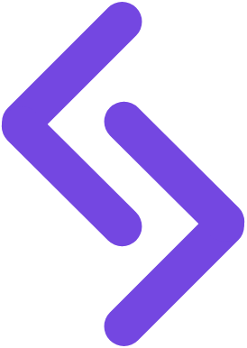

<div align="center">

  

# 📚 Lógica Lab</h1>

**Aulas visuais e interativas sobre Lógica de Programação para iniciantes.**
*Aprende mexendo, não decorando.*

[](#%EF%B8%8F-stack)
[](#%EF%B8%8F-stack)
[](#%EF%B8%8F-stack)

</div>

---

## 🎯 O que é isso

Um conjunto de aulas sobre Lógica de Programação e seus conceitos fundamentais, cada uma como uma página HTML única e interativa. Tudo em **HTML, CSS e JavaScript puros**, zero dependências, direto no navegador.

Você interage com exemplos reais, vê algoritmos funcionando ao vivo, clica em diagramas práticos. Os conceitos abstratos viram concretos e visuais.

> 🌐 **Página inicial com todas as aulas:** abre o `index.html` na raiz.

---

## 📚 As aulas

Cada aula é uma página independente sobre um tema específico de lógica. Você pode começar pela 1 ou pular para a aula que te interessa mais.

| # | Tema | Categoria | Tópicos principais |
|---|------|-----------|------------------|
| **[01](aula1/)** | Introdução à Lógica | Fundamentos | Conceitos · Variáveis · Tipos · Operadores |
| **[02](aula2/)** | Estruturas Condicionais | Controle | If/Else · Switch · Operadores Lógicos |
| **[03](aula3/)** | Loops e Iterações | Controle | For · While · Break/Continue |
| **[04](aula4/)** | Arrays e Listas | Estruturas | Declaração · Indexação · Métodos |
| **[05](aula5/)** | Funções | Modularização | Declaração · Parâmetros · Recursão |
| **[06](aula6/)** | Strings | Estruturas | Concatenação · Métodos · Busca |
| **[07](aula7/)** | Objetos | Estruturas | Criação · Propriedades · Métodos |
| **[08](aula8/)** | Algoritmos Clássicos | Algoritmos | Busca · Ordenação · Fibonacci |
| **[09](aula9/)** | Complexidade | Otimização | Big O · Análise · Trade-offs |
| **[10](aula10/)** | Boas Práticas | Avançado | Design Patterns · Clean Code · Testing |

---

## ✨ Por que esse formato funciona

- 🖱️ **Interativo de verdade**: simuladores, diagramas clicáveis, execução visual. Não é vídeo, não é PDF, é manipulação direta
- 📦 **Zero dependências**: só HTML, CSS e JS puros. Abre direto no navegador, funciona offline, hospeda em qualquer lugar (GitHub Pages, S3, Netlify...)
- 🎨 **Identidade visual consistente**: mesma paleta azul, mesmas fontes (Caprasimo + Sora + JetBrains Mono), mesmo "feel" moderno em todas as aulas
- 📱 **Responsivo de verdade**: 768px breakpoint adapta grid, fontes, navegação e cards. No mobile o site continua funcional e legível
- 🧠 **Foco em Lógica pura**: independente de linguagem de programação. Aprenda os fundamentos de verdade

---

## 💻 Tecnologias

| Tecnologia | Descrição | Propósito |
|-----------|-----------|----------|
| **JavaScript** | Vanilla (ES6+) | Simuladores e interatividade |
| **HTML5** | Semântico | Marcação e estrutura |
| **CSS3** | Flexbox, Grid, Animações | Estilização e layout moderno |
| **[Caprasimo](https://fonts.google.com/specimen/Caprasimo)** | Google Fonts | Headings e títulos |
| **[Sora](https://fonts.google.com/specimen/Sora)** | Google Fonts | Corpo do texto |
| **[JetBrains Mono](https://fonts.google.com/specimen/JetBrains+Mono)** | Google Fonts | Código e tags |

---

## 🗂️ Estrutura

```
logica-lab/
├── index.html              # Landing com cards de todas as 10 aulas
├── css/
│   └── style.css           # Estilos compartilhados da landing
├── js/
│   ├── aulas.js           # Dados e renderização dinâmica dos cards
│   └── script.js          # Interatividade (smooth scroll, animations)
├── img/
│   ├── logo.png           # Identidade visual
│   ├── logica-3d.webp     # Imagem da hero
│   ├── right-arrow.png    # Ícone dos links
│   └── favicon.ico        # Favicon
│
├── aula1/                  # 10 aulas (1-10)
│   ├── index.html         # Marcação semântica
│   ├── style.css          # Visual (paleta, layout, animações)
│   └── script.js          # Interatividade (simuladores, widgets)
├── aula2/
├── aula3/
├── ...
└── aula10/
```

Cada aula é uma página independente em **arquitetura modular**: HTML cuida da estrutura, CSS dos estilos e JS da interatividade. Sem dependências externas, abre direto no navegador, funciona offline.

---

## 🚀 Como rodar localmente

Abre direto no navegador:

```bash
# clone
git clone https://github.com/rhayssakramer/logica-lab.git
cd logica-lab

# abre o index.html com duplo-clique, ou serve um http simples:
python -m http.server 8000
# depois acessa http://localhost:8000
```

Não precisa de `npm install`, não tem `package.json`, não tem build step.

---

## 📋 Dicas de Lógica inclusos

Na página inicial, há uma seção com **6 dicas práticas** que você precisa saber:

1. **Divida para Conquistar** — Quebre problemas complexos em partes menores
2. **Pseudocódigo Antes** — Escreva a lógica em linguagem natural primeiro
3. **Trace Manualmente** — Execute o código passo a passo no papel
4. **Use Fluxogramas** — Visualize decisões e loops com diagramas
5. **Nomes Descritivos** — Use nomes de variáveis que explicam tudo
6. **Teste Casos Extremos** — Sempre teste com valores mínimos, máximos e nulos

---

## 🌐 Deploy no GitHub Pages

Está hospedado em **GitHub Pages** automaticamente:

```
https://rhayssakramer.github.io/logica-lab/
```

Qualquer push na branch `main` atualiza o site automaticamente.

---

## 🤝 Contribuindo

Issues e PRs são bem-vindos, especialmente para:

- Adicionar novas aulas (Estruturas avançadas, Grafos, etc.)
- Melhorar simuladores interativos
- Tradução para inglês ou espanhol
- Melhorar acessibilidade (ARIA, contraste, foco visível)
- Corrigir bugs
- Adicionar mais dicas e truques

---

## 👩🏼‍💻 Autora

<table>
  <tr>
    <td align="left">
      <a href="https://github.com/rhayssakramer">
        <strong>Rhayssa Kramer</strong>
      </a>
      <br>
      <span>Sr. Assoc, Full-Stack Development | Engenheira de Plataforma</span>
      <br>
      <small>Avanade | Tech Enthusiast | Community Speaker</small>
    </td>
  </tr>
</table>

---

## 📄 Licença

MIT — usa, adapta, distribui. Só dá os créditos. 🏷️

---

<div align="center">

Feito com 🧡 para quem quer aprender Lógica de Programação de verdade

*"Os alunos aprendem mexendo, não decorando."*

<div align="center">

### ⭐ Se este projeto foi útil, considere deixar uma estrela no GitHub!

© 2026 Rhayssa Kramer. Todos os direitos reservados.

<a href="https://github.com/rhayssakramer"></a>

</div>

</div>
